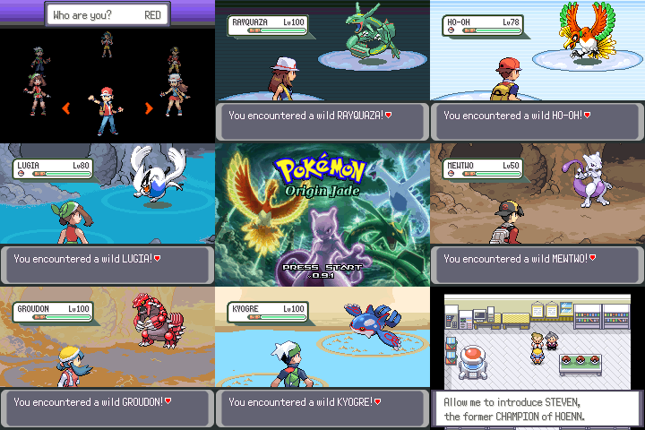
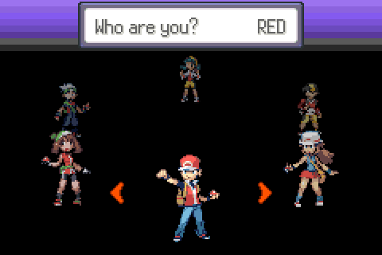
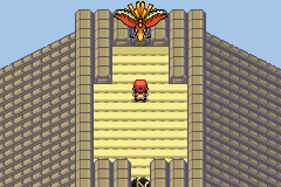
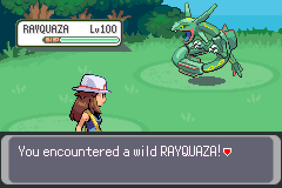
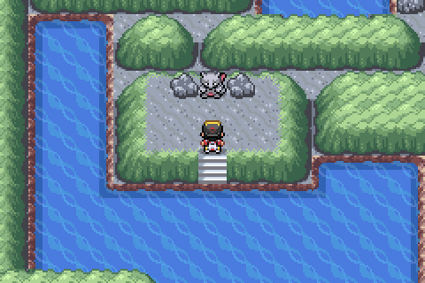
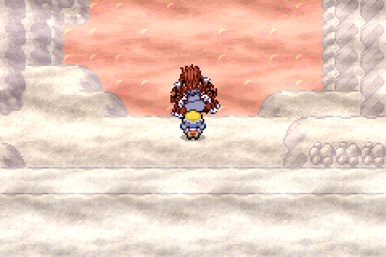
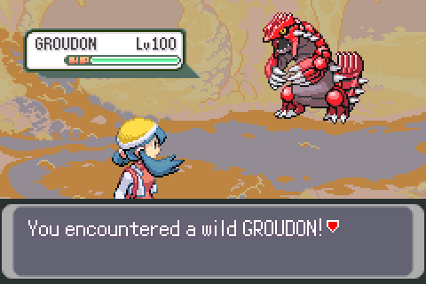
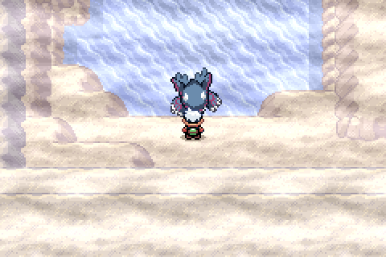
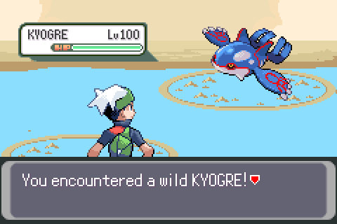
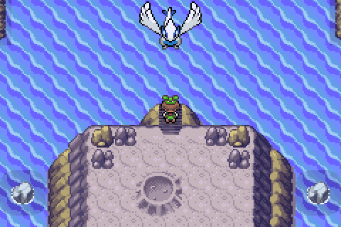

# About Pokémon Origin Jade



**Pokémon Origin Jade** is a GBA ROM hack that takes you on one journey
through three regions: Kanto first, then Johto, then Hoenn.
Kanto uses the FireRed/LeafGreen maps, Johto comes from
[Pokémon Heart & Soul 2.0.5](https://github.com/PokemonHnS-Development/pokehns-expansion),
Hoenn from Emerald.
It is built on **`pokemonHnS-expansion`** (Heart & Soul) and
[RHH's **`pokeemerald-expansion`**](https://github.com/rh-hideout/pokeemerald-expansion),
which in turn build on [pret's **`pokeemerald`**](https://github.com/pret/pokeemerald)
decompilation project.

> Start in Pallet Town, win three leagues, meet the legends of all three
> regions, and play it as Red, Leaf, Gold, Kris, Brendan or May.

The game is available in **German and English**. The current beta is
**v0.9.1**; saves from older beta versions do not load in it, so start a
new game.

# Features

- **Three regions in a row**, each with its own badges, league and title.
  Field moves follow the region's rules (Kanto badges, Johto permits,
  Hoenn licenses). The credits roll at the end of the whole journey.
- **Six player characters**: pick Red, Leaf, Gold, Kris, Brendan or May on
  a character wheel at the start. Your character is used everywhere: on
  the map, in battle, on the Trainer Card and in the Hall of Fame. Leave
  the name empty to take the character's own name, or press B on an empty
  name to go back to the wheel.
- **Your Hoenn rival** is May, or Brendan if you play as May.
- **Fixed levels per area**: trainers and wild Pokémon have set levels
  that rise from Kanto through Johto to Hoenn; they no longer follow your
  team. Experience is tuned per region.
- **Kanto in the FireRed/LeafGreen style**, with day and night encounters,
  trainers who register in your PokéGear and call for rematches, and gym
  leader rematches after the Kanto title (stronger again after the Johto
  title).
- **Stronger league after the title**: the Johto Elite Four and Lance bring
  new teams after the Johto title and again after you beat Red on
  Mt. Silver. In league rematches and against Red the strongest Pokémon is
  always at least one level above the level expected at your progress.
- **Pokédex with 422 entries**: all of Gen 1 to 3 plus 36 later
  evolutions and baby Pokémon, each listed with its family.
- **Pokédex rewards from Prof. Oak** for the Kanto, Johto and Hoenn dex,
  and Prof. Birch gives you Treecko, Torchic and Mudkip for a complete
  Hoenn dex.
- **Celebi**: carry Oak's GS Ball to Prof. Elm. Once you have caught
  Raikou, Entei and Suicune, Elm sends it to Kurt, and the ball leads you
  to the shrine in Ilex Forest.
- **Legendary battles in their own scenery**: Rayquaza on Sky Pillar,
  Kyogre and Groudon in their caves and Ho-Oh on Tin Tower each have a
  battle background of their own.
- **Region rule**: Pokémon of a region show up once the story reaches it.
- **Steven's story**: after the Johto title Steven (Troy in the German
  version) brings the Hoenn Ticket to Prof. Oak's lab.
- **Contests as in Ruby and Sapphire**, one rank per contest hall.
- **Battle Frontier and Trainer Hill** from Heart & Soul.
- **No trading needed**: every species and every item can be obtained in
  one game.
- **Challenges** for a new game: Nuzlocke, randomizer, level caps and more.

# Screenshots

## Choose your character

<p align="center">
  
</p>

## Steven visits Prof. Oak's lab

<table>
  <tr>
    <td align="center"><br>Prof. Oak introduces Steven</td>
    <td align="center"><br>Steven hands over the Hoenn Ticket</td>
  </tr>
</table>

## Six characters, six legends

<table>
  <tr>
    <td align="center"><br><br>Ho-Oh on Tin Tower, playing as Red</td>
    <td align="center"><br><br>Rayquaza on Sky Pillar, playing as Leaf</td>
  </tr>
  <tr>
    <td align="center"><br><br>Mewtwo in Cerulean Cave, playing as Gold</td>
    <td align="center"><br><br>Groudon in Terra Cave, playing as Kris</td>
  </tr>
  <tr>
    <td align="center"><br><br>Kyogre in Marine Cave, playing as Brendan</td>
    <td align="center"><br><br>Lugia in the Whirl Islands, playing as May</td>
  </tr>
</table>

# Playing

Apply the BPS patch to a clean Pokémon Emerald ROM (USA/Europe,
SHA-1 `f3ae088181bf583e55daf962a92bb46f4f1d07b7`), for example with
[Rom Patcher JS](https://www.marcrobledo.com/RomPatcher.js/) or Floating
IPS. Patches are published with each beta release.

# Multiplayer compatibility

- Trades and link battles come from Heart & Soul and were not tested in
  Origin Jade.
- Origin Jade is not compatible with the official Pokémon games, Heart &
  Soul or other **`pokeemerald-expansion`** projects.

# Building

Install `gcc-arm-none-eabi`, `binutils-arm-none-eabi`,
`libnewlib-arm-none-eabi`, `libpng-dev` and Python 3, then:

    make -j$(nproc)                      # Pokemon_Origin_Jade.gba (German beta build, debug menus on)
    make -j$(nproc) GAME_LANG=ENGLISH    # Pokemon_Origin_Jade_EN.gba (English beta build)
    make release                         # Pokemon_Origin_Jade-release.gba (debug menus off)
    make release GAME_LANG=ENGLISH       # Pokemon_Origin_Jade_EN-release.gba

Check tools and rules for changes: [`DEVELOPMENT.md`](DEVELOPMENT.md).

# Credits

Origin Jade stands on a chain of projects. If you use it, credit Origin
Jade and keep the full chain:

- **Pokémon Heart & Soul** (pokemonHnS-expansion) 2.0.5 by the HnS team,
  [PokemonHnS-Development/pokehns-expansion](https://github.com/PokemonHnS-Development/pokehns-expansion).
  Its contributors are listed in [`CREDITS.md`](CREDITS.md).
- **Modern Emerald** by resetes12,
  [resetes12/pokeemerald](https://github.com/resetes12/pokeemerald), the
  base Heart & Soul was first built on.
- **pokeemerald-expansion** by RHH (Rom Hacking Hideout),
  [rh-hideout/pokeemerald-expansion](https://github.com/rh-hideout/pokeemerald-expansion),
  version 1.15.1 with later unreleased changes
  (`include/constants/expansion.h`) and selected fixes up to 1.17.1.
- **pokeemerald** by pret,
  [pret/pokeemerald](https://github.com/pret/pokeemerald), the
  decompilation all of these build on.

Heart & Soul asks everyone who uses it to credit Pokémon Heart and Soul,
to retain the full chain of credits, and, with a more recent
pokeemerald-expansion, to credit RHH with the version number. For example:

```
Pokémon Origin Jade is based on Pokémon Heart & Soul 2.0.5
(pokemonHnS-expansion), built on resetes12's Modern Emerald and RHH's
pokeemerald-expansion 1.15.1, which build on pret's pokeemerald.
```

Please also consider crediting all contributors listed in
[`CREDITS.md`](CREDITS.md).
